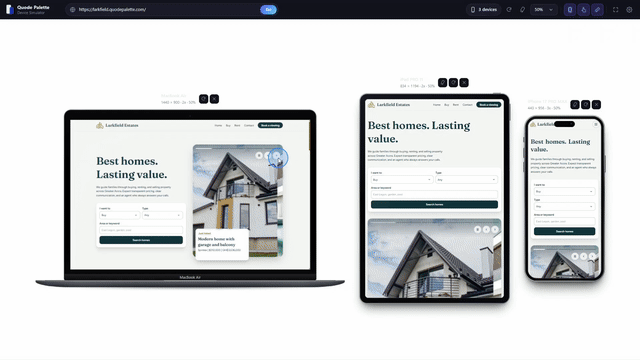

# Quode Palette Device Simulator

A Chrome extension for previewing a website on phones, tablets, laptops and more, side by side, without leaving your browser.

Open it on any site, and you get a MacBook Air, an iPad Pro 11 and an iPhone 17 Pro Max showing the same page. Scroll, click or type in one device and the others follow.

<p align="center">
  
</p>

## Install

The extension is not on the Chrome Web Store yet, so you load it as an unpacked extension.

1. Download or clone this repository.
2. Open `chrome://extensions`.
3. Turn on **Developer mode** (top right).
4. Click **Load unpacked** and select the project folder.
5. Pin the extension to your toolbar if you like.

Chrome 111 or newer is required.

### Previewing local files (`file:///`)

To simulate a page from your disk, such as `file:///Z:/GAME%20DLL/REPOS/Files-main/index.html`:

1. Open `chrome://extensions`, click **Details** on this extension and turn on **Allow access to file URLs**. Chrome does not allow this to be granted automatically.
2. Open the local file in a tab and click the toolbar icon, or paste a `file:///` URL or a plain path such as `Z:\GAME DLL\REPOS\Files-main\index.html` into the simulator's address bar.

## How to use it

- **Open:** click the toolbar icon on any website, or press `Alt+Shift+M`. The simulator opens in the same tab with the default devices at 50% zoom.
- **Close:** click the icon again. You go back to the page you were previewing. A purple `ON` badge on the icon shows when the simulator is active.
- **Browse:** click a bookmark or a link while the simulator is open and the new site loads inside it. Typing a URL in the address bar, reloading and the back button still work normally, so you can always leave.
- **Right click:** use "Open in Quode Palette Simulator" on a page or a link.

Keyboard shortcuts inside the simulator: `R` rotates the devices, `F` toggles fullscreen and `Esc` leaves fullscreen.

## Features

- 80+ built-in devices (iPhones, Android phones, tablets, watches, laptops, monitors) with search and favorites, plus your own custom devices.
- Up to 3 devices at once.
- Synchronized scrolling, clicks and typing across all devices. Scrolling can follow either the same page position or exact pixels.
- Realistic frames with metal bodies, side buttons, Dynamic Island, notches, punch-hole cameras, foldable hinges and more. Frames can be turned off or recolored.
- Touch emulation: drag to scroll with inertia, touch events, and a spoofed user agent, screen size and pixel ratio.
- Rotate, zoom (Fit, 25% to 125%), fullscreen and PNG screenshots with or without the frame.
- Light and dark interface with a configurable stage background.

## How it works

- `background.js` is the service worker. It handles the toolbar icon, the context menu and navigation, and it adds a rule that is limited to the simulator tab. That rule removes `X-Frame-Options` and `Content-Security-Policy` from sub-frames so pages can load inside the device frames, and it sets the `User-Agent` header for them.
- `inject.js` runs inside each device frame. It spoofs the device identity, turns mouse drags into touch input, and reports scroll position, clicks and typing so the simulator can mirror them. It does nothing on pages outside the simulator.
- `simulator/` holds the simulator page: the device picker, settings, layout and the frame rendering.
- Syncing uses a leader and follower model. The device you interact with leads, and the others are updated to match. Echoes from those updates are ignored, so devices never fight each other.

## Limitations

- This is a simulator, not an emulator. It does not run the iOS or Android engines, so always check important work on a real device.
- In compare mode all frames share one `User-Agent` header (from the first device). The user agent that page scripts see is correct for each device.
- Sites that rely on cookies may look logged out, because cookies are third party inside a frame.
- CSS `@media (hover)` and `(pointer)` rules in stylesheets cannot be rewritten. Only `matchMedia` calls are.
- Scroll sync follows the page's main scroller. Small scrollable panels inside a page are not synced.
- Clicks that open a new tab or window happen only on the device you clicked, so you do not get three tabs.
- Video recording and network throttling are not available yet.

## Project structure

```
.
├── LICENSE
├── manifest.json
├── background.js
├── inject.js
├── icons/
└── simulator/
    ├── simulator.html
    ├── simulator.css
    ├── simulator.js
    └── devices.js
```


## License

Released under the [PolyForm Noncommercial License 1.0.0](LICENSE). You are free to use, modify and share it for personal, educational and other noncommercial purposes. For commercial use, please get in touch.
[Email Us](mailto:hello@quodepalette.com)

